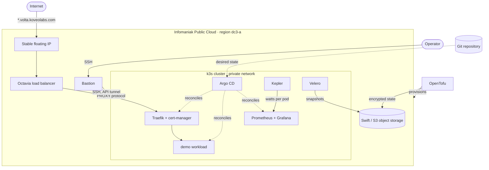

# volta

[](https://github.com/Mbekenniche/volta/actions/workflows/checks.yaml)

A Kubernetes platform on the Infomaniak Public Cloud (OpenStack), built, destroyed and rebuilt from
code, then instrumented to show what each workload costs in watts, grams of CO2 and money.

## Why

In the cloud, a pod drawing 40 W looks exactly like one drawing 4 W. volta builds a complete
platform from nothing, then adds the signal most platforms lack: energy and carbon per workload,
shown next to what it costs.

Two rules hold the project together:

- **One command builds it, one destroys it.** A step that cannot survive a full rebuild is not done.
- **Every figure states its margin of error.** Inside a virtual machine, power is estimated, never
  read from hardware, and the repository says so.

## Architecture



The target, not yet the current state: see the status below.

## Stack

| Layer | Tools |
|---|---|
| Cloud | OpenStack on Infomaniak: Nova, Neutron, Octavia, Cinder, Swift |
| Infrastructure as code | OpenTofu and cloud-init; state in Swift through S3, encrypted |
| Kubernetes | k3s, three servers across three availability zones, embedded etcd |
| Ingress | Octavia load balancer on a stable address, Traefik, cert-manager, Let's Encrypt |
| Delivery | Argo CD as an app of apps, Helm charts |
| Observability | Prometheus, Grafana, etcd's metrics, Prometheus on a Cinder CSI volume |
| Backups | Velero to Swift, volumes copied with kopia, restore proven |
| Lifecycle and CI | `make up` and `make down`; GitHub Actions with no secret, every action pinned to a commit |
| Energy and carbon | Per-pod power estimates, Prometheus rules, Grafana *(planned)* |

## Status

**Phase 1 — the platform**

- [x] Private network, encrypted remote state, three nodes behind a bastion
- [x] k3s from a single `apply`
- [x] HTTPS through an Octavia load balancer: Traefik, cert-manager, Let's Encrypt
- [x] GitOps: Argo CD delivers everything in the cluster from this repository
- [x] Observability: Prometheus and Grafana, etcd's metrics over time
- [x] Backups, proven by a real restore
- [x] One command to build, one to destroy, and CI on every change

**Phase 2 — energy and carbon**

- [ ] Power per pod, a carbon model, dashboards as code, and one optimisation measured before and after

## Build it

From the workstation, with what the [lifecycle runbook](docs/runbooks/lifecycle.md) lists:

```sh
make up     # a plan, a typed yes, the apply, then everything up to the demo over HTTPS
make down   # the main stack and its volumes; the state, the stable address and the backups stay
```

A stopped `make up` resumes when run again. The CI checks every pull request and holds no secret.

## A few things that broke

- Swift refuses the conditional write a state lock needs.
  [Read](docs/what-broke.md#a-state-lock-the-platform-cannot-take)
- Octavia refused a health monitor for its type; the error came from its database.
  [Read](docs/what-broke.md#a-health-monitor-refused-for-a-type-that-was-fine)
- A rule on `main` without its required checks let a red pull request through.
  [Read](docs/what-broke.md#a-rule-on-main-that-let-a-red-pull-request-through)

## Read more

- [Decisions](docs/adr/): the five that shape the platform
- [What broke](docs/what-broke.md) and [known limitations](docs/limitations.md)
- Runbooks: [lifecycle](docs/runbooks/lifecycle.md), [access](docs/runbooks/access.md),
  [restore](docs/runbooks/restore.md)
- [Platform inventory](docs/platform-inventory.md): what the cloud offers, and what it costs

## License

MIT. See [LICENSE](LICENSE).
